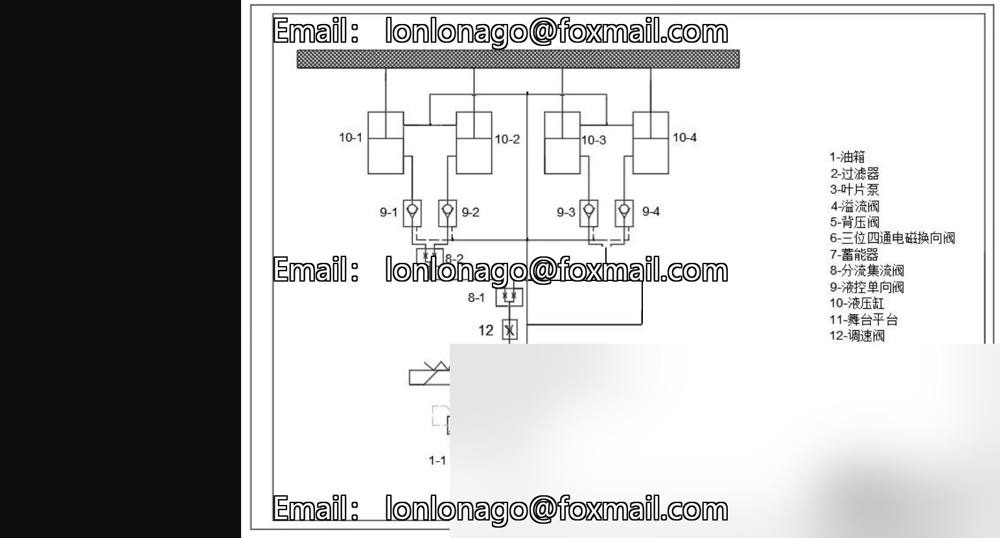
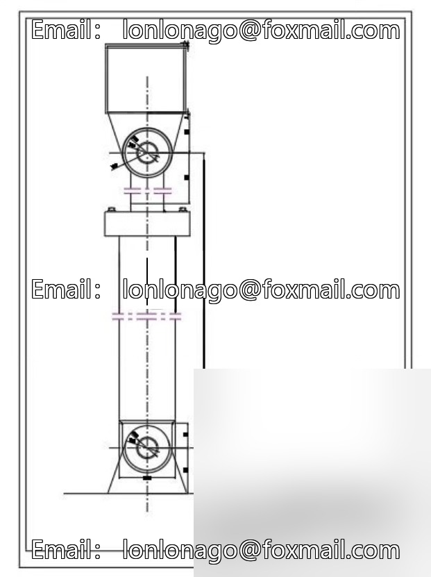
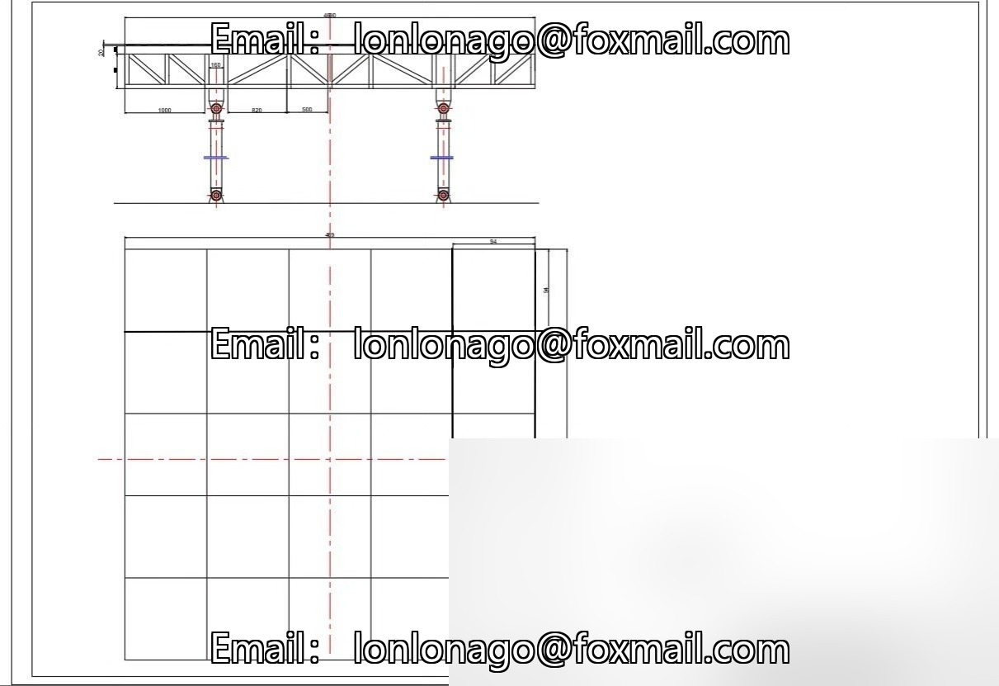
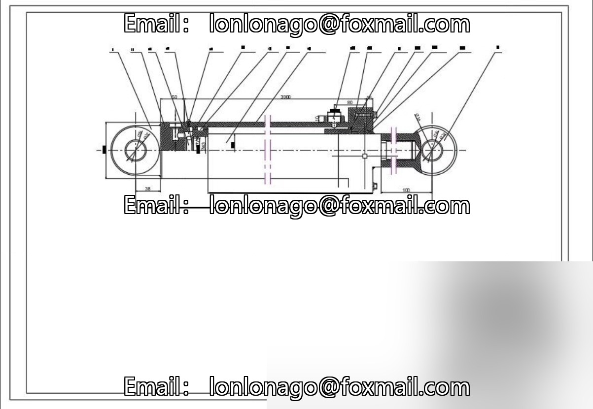

# Stage lift hydraulic system design; stage lift design; stage lift hydraulic CAD drawing; dance stage lift design

## Body

Stage lift hydraulic system design; stage lift design; stage lift hydraulic CAD drawings; stage lift drawings
411 The design process includes: clarifying the transmission process, calculating relevant data, drawing the hydraulic system principle diagrams, etc.
Including CAD drawings and design explanations

The design covers stage lift hydraulic systems, including CAD drawings and design notes; the process includes clarifying the transmission, computing data, and drawing hydraulic system schematics. The images also show components such as fuel tank, filter, blade pump, overflow valve, back-pressure valve, solenoid valve, accumulator, split flow valve, control one-way valve, hydraulic cylinders, stage platform, speed control valve, and drawing files.

<!-- AI_ENRICHED -->

## Images

## Payment

Here is a pay link on Stripe ( https://buy.stripe.com/3cs8yP7sY87d0vu9AB ). Please contact me lonlonago@foxmail.com after funding $89, and I will send you a complete data files , thank you!

